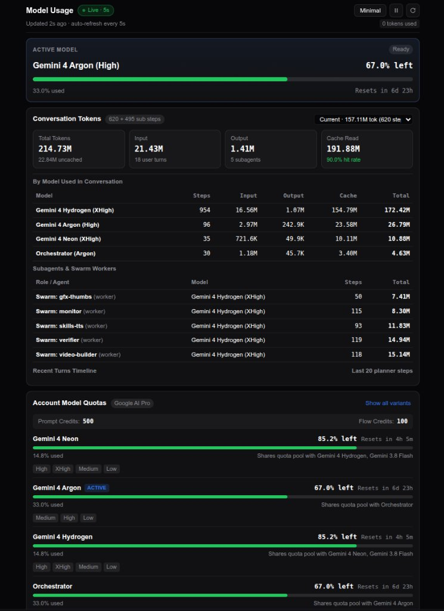
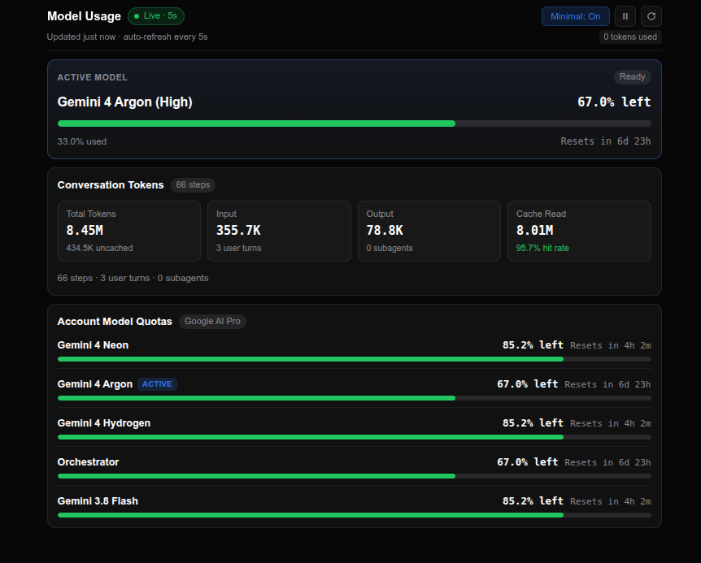

# Antigravity Model Usage (`model-usage`)

A real-time, **zero-token**, zero-dependency UI Plugin (Sidecar) for **Google Antigravity** that displays both your **Account Model Quotas & Reset Timers** and **Conversation + Subagent Token Usage** in the auxiliary side pane, refreshing automatically every **5 seconds**.

[](LICENSE)

---

## Screenshots

### Full Dashboard View (Default)
Shows the active model spotlight gauge, conversation & subagent/swarm token breakdown (with per-model and per-subagent tables), account-wide model quotas with shared quota pool indicators, and local workspace rollup:



### Minimal View (`Minimal: On`)
One click on the **`Minimal`** button in the top-right header (saved automatically across sessions) compacts the panel to just the active model quota bar, conversation token totals, and active quota pools:



---

## Features

- **Selectable in Every Conversation:** Appears in the conversation header's auxiliary (right-hand) side pane `+` menu as **Model Usage**, or can be opened directly from chat via a `[Model Usage](sidecar://model-usage/usage_monitor/)` pill.
- **0 Model Tokens Consumed:** Runs as a lightweight local Node.js sidecar that reads local conversation transcripts (`transcript.jsonl`) and queries the local Antigravity Language Server (`GetUserStatus`) over loopback. Leaving it open 24/7 uses **0 LLM tokens** and **0 prompt/flow credits**.
- **Negligible CPU & Disk Footprint:**
  - **Stat-Based File Caching:** Checks `fs.statSync` (`mtimeMs:size`) before reading any transcript file — unchanged files are never re-read or re-parsed across 5-second ticks.
  - **ETag Short-Circuiting:** When neither quotas nor conversation transcripts have changed since the last poll, `/api/usage` returns `{ unchanged: true }` (~50 bytes) and the browser skips DOM updates.
  - **Visibility-Aware Polling:** Automatically pauses the 5-second timer when the side pane or window is hidden (`visibilitychange`) and refreshes immediately when visible again.
- **Subagent & Native Swarm Aggregation:** Automatically discovers and sums token usage across spawned subagents (`invoke_subagent`) and native Swarm workers (`.system_generated/swarm/members.json`).
- **Full & Minimal View Modes:** Switch anytime between the detailed dashboard and a compact minimal view, or expand all 24 individual thinking-level variants (`Low`, `Medium`, `High`, `XHigh`).
- **Native Theme Syncing:** Automatically adapts to Antigravity's Light and Dark themes via `/preload.js` CSS variables (`--background`, `--foreground`, `--primary`).

---

## Installation & Usage

### Prerequisites
- **Google Antigravity** installed on Linux, macOS, or Windows (uses Antigravity's bundled Node.js runtime; no `npm install` or external packages required).

### Step 1: Clone and Install
Clone this repository and run `./install.sh` to install the plugin into your global Antigravity customizations directory (`~/.gemini/config/plugins/model-usage`):

```bash
git clone https://github.com/Siddharth-Chandran/antigravity-model-usage.git
cd antigravity-model-usage
chmod +x install.sh
./install.sh
```

*(Windows users or manual installs: copy `plugin.json`, `README.md`, `assets/`, `skills/`, and `sidecars/` into `%USERPROFILE%\.gemini\config\plugins\model-usage\` or `~/.gemini/config/plugins/model-usage/`.)*

### Step 2: Open in Any Conversation
Once installed, Antigravity discovers the plugin and starts the sidecar automatically (no restart required):

1. **From the Side Pane UI:** In any Antigravity conversation, click the **`+`** button in the auxiliary (right-hand) side pane header and select **Model Usage**.
2. **From Chat:** Ask the agent *"Open the Model Usage panel"* and click the **[Model Usage](sidecar://model-usage/usage_monitor/)** pill that appears in the reply.

### Controls Inside the Panel
- **`Minimal` / `Minimal: On`:** Toggles between the Full Dashboard and Minimal view (saved in `localStorage`).
- **Pause (`||`) / Play (`▶`):** Pauses or resumes the 5-second auto-refresh timer.
- **Refresh (`↻`):** Triggers an immediate poll.
- **Conversation Dropdown (Full Mode):** Switch between the current conversation and any of your recent local conversations.
- **`Show all variants` / `Group by family` (Full Mode):** Toggle between grouped model families and individual thinking-level variants (`Low`, `Medium`, `High`, `XHigh`).

---

## Standalone Browser Preview & Testing

Run the automated unit and HTTP integration test suite using Node's built-in test runner (zero dependencies):

```bash
npm test
# or directly:
node --test
```

Preview the sidecar UI standalone in any desktop browser outside Antigravity:

```bash
ANTIGRAVITY_SIDECAR_WEB_PORT=4150 node sidecars/usage_monitor/main.mjs
# Open http://127.0.0.1:4150/
```

---

## Repository Structure

```text
antigravity-model-usage/
├── plugin.json                        # Antigravity plugin manifest
├── install.sh                         # One-step installer into ~/.gemini/config/plugins/model-usage
├── LICENSE                            # MIT License
├── assets/
│   ├── logo.svg                       # High-contrast square SVG gauge icon
│   └── screenshots/
│       ├── full-view.png              # Full dashboard mode screenshot
│       └── minimal-view.png           # Minimal mode screenshot
├── skills/
│   └── model-usage/
│       └── SKILL.md                   # Agent skill to surface the sidecar:// pill in chat
├── sidecars/
│   └── usage_monitor/
│       ├── sidecar.json               # Sidecar AUX_PANE declaration
│       ├── main.mjs                   # sidecar_sdk HTTP server with standalone node:http fallback
│       ├── usage_collector.mjs        # Quota normalizer, transcript/subagent parser & mtime cache
│       ├── index.html                 # Side-pane HTML layout
│       ├── styles.css                 # Host-theme-synced stylesheet (Full & Minimal modes)
│       └── app.js                     # 5s live polling loop, ETag handling & interactive controls
└── test/
    ├── usage_collector.test.mjs       # Unit tests for all parser & quota corner cases
    └── server.test.mjs                # Integration tests for HTTP routes, ETag, and UI contract
```

---

## License

This project is licensed under the [MIT License](LICENSE).
